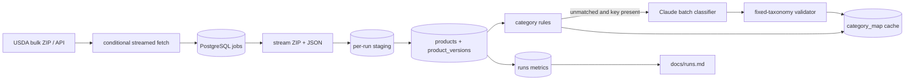

# grocery-ingest

An incremental, restartable ingestion pipeline for the official USDA FoodData Central Branded Foods dataset. It streams bulk snapshots into PostgreSQL, retains content-changing versions, checks API deltas, and normalises manufacturer category strings into a fixed grocery taxonomy.

## Architecture



The stable product key is a GTIN/UPC with leading zeroes removed, falling back to `fdc:<fdcId>` when GTIN is absent. The implementation keeps only the newest publication/modified date when a normalized GTIN repeats inside one release. Cross-release proof that GTIN remains stable while FDC IDs change is still pending: the restricted build environment could not download the official snapshot, so this README does not claim an observation that was not made.

Stored content is canonicalized with sorted object keys and nutrient numbers, then SHA-256 hashed. FDC IDs and publication/modified dates are excluded, so an identical republish is unchanged. A merge writes `product_versions` only for inserts or content changes and still advances `last_seen_run` for unchanged products. Snapshot checks use saved ETag/Last-Modified values; HTTP 304 records `not_modified` without downloading or ingesting.

## Setup

Requirements are Node 24 and PostgreSQL 16. PostgreSQL binaries default to `C:/Program Files/PostgreSQL/16/bin`; override `PG_BIN` where needed.

```powershell
Copy-Item .env.example .env
npm install
npm run db:init
npm run migrate
npm run check
```

Do not put keys anywhere except the gitignored `.env`. `FDC_API_KEY` may be a free api.data.gov key or `DEMO_KEY`; without it the API delta logs a skip. Without `ANTHROPIC_API_KEY`, unmatched categories remain uncategorized and no AI calls are made.

## Commands

```powershell
npm run ingest -- --snapshot 2025-04-24
npm run sync
npm run worker
npm run scheduler
npm run categorize
npm run eval
npm run report
```

`sync` is a one-shot snapshot check plus optional API delta and drains currently runnable jobs. `scheduler` enqueues the same work every 24 hours by default (`SYNC_INTERVAL_HOURS`) while continuously running the worker. Retries use bounded exponential backoff with jitter and become `dead` after their configured maximum attempts.

For cron, run `0 2 * * * cd /path/to/grocery-ingest && npm run sync`. On Windows Task Scheduler, the action can be `cmd.exe /c "cd /d C:\path\to\grocery-ingest && npm run sync"` with a daily trigger.

## Measured results

The authoritative generated table is [docs/runs.md](docs/runs.md). It has not been populated because the current environment could not reach the USDA archive or create the external PostgreSQL data directory. No counts or skip rates are copied here until that report exists.

## Category evaluation

The generated evaluation report is [docs/eval.md](docs/eval.md). The AI recording is intentionally marked `NOT YET RECORDED`, and the gold set remains explicitly ungenerated rather than being filled with invented category strings.

## Limits

- Missing-GTIN records use the release-specific FDC ID and therefore cannot be linked across a later FDC-ID change.
- API deltas are publication-date based; late corrections with an older publication date require a future bulk snapshot.
- Manufacturer categories are ambiguous. Rules are deterministic; AI output is validated and cached, but flagged fallbacks need review.
- The pipeline is single-request and single-worker by design. PostgreSQL locking permits more workers, but USDA API requests should remain sequential and respectful.

