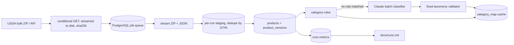

# grocery-ingest

An incremental ingestion pipeline for the official USDA FoodData Central **Branded Foods** dataset. It covers about 455,000 US grocery products (public domain). It streams the bulk releases into PostgreSQL and skips anything that has not changed, at three levels: file, record and row. It records metrics for every run and uses an AI model in one narrow place: cleaning up messy manufacturer category names, with an eval set that measures whether it is right.

TypeScript on Node 24, PostgreSQL 16, no paid services.

## Architecture



- **Queue:** jobs live in a Postgres table. Workers claim them with `FOR UPDATE SKIP LOCKED`. A failure retries with exponential backoff plus jitter (capped at 1 hour) and is marked `dead` after its maximum attempts.
- **Streaming:** the 204 MB zip (about 3 GB of JSON) is never loaded into memory. It is streamed from disk, unzipped and parsed record by record.
- **Staging:** records go into a per-run staging table in batches of 1,000, then one transaction merges them into `products`.

## How it avoids re-processing what has not changed

There are three layers of checks. Each one is cheaper than the one after it.

1. **Conditional GET on the bulk file.** The saved ETags go out in `If-None-Match`, and an unchanged file returns `304` with no body. While testing I found that USDA serves the files from load-balanced nginx backends. Each backend reports a *different* ETag and Last-Modified for the same bytes, so a single saved ETag misses about half the time. The pipeline keeps every ETag it has seen for the current file (`source_state.known_etags`). It also keeps the file's SHA-256: if a new backend answers `200` but the bytes hash the same, the run is recorded as `unchanged_file`, the new ETag is remembered, and nothing is re-ingested.
2. **Per-record content hash.** Each product is normalised, then the stored fields are hashed as canonical JSON with SHA-256 (sorted keys, nutrients sorted by number). Volatile fields (`fdcId`, publication and modified dates) are left out, so an identical re-publish counts as unchanged.
3. **Idempotent upsert keyed by a stable ID.** `INSERT ... ON CONFLICT (product_id) DO UPDATE ... WHERE content_hash IS DISTINCT FROM EXCLUDED.content_hash`. Unchanged rows are never rewritten, and `RETURNING (xmax = 0)` separates new rows from changed ones. Only new or changed rows get a row in `product_versions`. A separate update advances `last_seen_run`, so products that drop out of a release are counted as `missing`.

**Stable ID.** FDC issues a new `fdcId` when a manufacturer updates a product. In the measured runs, 10,782 of the 32,454 products with more than one stored version had a different `fdcId` between versions. So the key is the GTIN/UPC with leading zeros stripped, falling back to `fdc:<fdcId>` only when there is no GTIN (no record lacked one in these releases). One release can list the same GTIN more than once (about 20,000 duplicate records per release). The newest `modifiedDate`/`publicationDate` wins.

**API delta.** The `foods/list` endpoint sorted by `publishedDate` acts as an updated-at cursor. It returns cut-down records with no ingredients, brand or category, so it is used only to find what was published since the cursor. Full records are then fetched from `/foods` in groups of 20 and go through the same hash and upsert path. It needs a free api.data.gov key (`FDC_API_KEY`) and was **not** run for the measured results below.

## Measured results

These numbers come from real runs on 18 Nov 2026, on one Windows laptop with local PostgreSQL 16. The full table, generated from the `runs` table by `npm run report`, is in [docs/runs.md](docs/runs.md). "Skip rate" means unchanged products divided by distinct products merged in that run.

| Run | Records seen | Distinct products | New | Changed | Unchanged (skipped) | Skip rate | Time |
|---|---:|---:|---:|---:|---:|---:|---:|
| 2025-04-24 release, first load | 452,998 | 432,992 | 432,992 | 0 | 0 | 0.0% | 7.0 min |
| 2025-12-18 release | 454,366 | 433,733 | 741 | 29,346 | 403,646 | 93.1% | 8.9 min |
| 2026-04-30 release | 455,458 | 432,559 | 287 | 5,311 | 426,961 | 98.7% | 10.6 min |
| 2026-04-30 again (same file) | 455,458 | 432,559 | 0 | 0 | 432,559 | 100.0% | 25.2 min |

- 1,362,822 source records processed across the three distinct releases (1,818,280 counting the repeat), and 434,020 products stored. The 2026-04-30 release dropped 1,461 products, which are counted as `missing`.
- Snapshot checks: the first check downloaded 204 MB (`200`). A second backend answered `200` with a different ETag, but the bytes were identical (`unchanged_file`, no ingest). The next four checks returned `304` with 0 bytes.
- Five checks failed during a short network outage. The queue retried them with backoff, and they finished on the next run. They are left in the table.
- The repeat load forced a full re-read of a file the checks would normally have skipped. It shows the row-level skip works on its own. It ran slower because it shared the machine with other work.
- Update frequency: USDA publishes a new Branded Foods bulk release a few times a year (the three releases used are about 4 to 8 months apart), plus API updates in between. The scheduler checks once every 24 hours, which costs one conditional request when nothing changed.

## Category evaluation (AI step)

USDA's `brandedFoodCategory` is free text from manufacturers: 350 distinct strings across 434,020 products, such as "Meat/Poultry/Other Animals  Prepared/Processed" (with a double space) next to "Meat/Poultry/Other Animals - Prepared/Processed". The AI step maps each *distinct string* (never each product) to one of 23 fixed aisles:

1. Keyword rules run first.
2. Strings the rules don't match go to Claude (`claude-haiku-5-5`) in batches of 50.
3. A validator rejects any label outside the taxonomy. A failed label is retried once, then set to `Other` and flagged.
4. Results are cached in `category_map`, so later runs call the model only for strings it has never seen.

The gold set is [eval/categories.gold.jsonl](eval/categories.gold.jsonl): 82 real strings from the data, labelled by hand using [eval/LABELLING.md](eval/LABELLING.md). `npm run eval` writes [docs/eval.md](docs/eval.md).

- **Rules only: 75.6% (62/82).** Typical mistakes: "Nut & Seed Butters" goes to Dairy because of "butter", and "Ketchup, Mustard, BBQ & Cheese Sauce" also goes to Dairy. 9 strings match no rule at all.
- **AI and combined: not measured yet.** The run needs an `ANTHROPIC_API_KEY` in `.env`. No AI answers have been recorded or made up. The eval reads AI answers from `eval/ai-responses.fixture.json`, which is marked `NOT YET RECORDED` until it holds real responses. CI then checks accuracy against that recording without needing a key.

## Setup

Requirements: Node 24 and PostgreSQL 16. The PostgreSQL binaries default to `C:/Program Files/PostgreSQL/16/bin`; override with `PG_BIN`. `db:init` creates a separate local cluster (UTF-8, port 5433, trust auth, no password) under `%LOCALAPPDATA%/grocery-ingest`, so it never touches an existing PostgreSQL install.

```powershell
Copy-Item .env.example .env
npm install
npm run db:init
npm run migrate
npm run check
```

Keys go only in the gitignored `.env`. Without `FDC_API_KEY` the API delta is skipped with a log line. Without `ANTHROPIC_API_KEY` the rules still run, unmatched categories stay uncategorised, and no AI calls are made.

## Commands

```powershell
npm run ingest -- --snapshot 2025-04-24   # load one release
npm run sync        # one-shot: snapshot check + API delta, drains the queue
npm run scheduler   # long-running: enqueues a sync every SYNC_INTERVAL_HOURS (default 24) and runs the worker
npm run worker
npm run categorize
npm run eval
npm run report      # writes docs/runs.md from the runs table
npm run check       # typecheck + tests (the definition of done)
```

To run on a schedule without a long-running process, use cron: `0 2 * * * cd /path/to/grocery-ingest && npm run sync`. On Windows Task Scheduler, use a daily trigger with `cmd.exe /c "cd /d C:\path\to\grocery-ingest && npm run sync"`.

## Tests and CI

`npm run check` runs `tsc --noEmit` and 22 `node:test` tests. They cover:

- hash determinism and volatile-field exclusion;
- GTIN normalisation and US date parsing;
- new, changed and unchanged counts against a real PostgreSQL;
- queue backoff, retry and dead-letter;
- conditional GET, including a two-backend ETag server like USDA's;
- the cursor logic;
- the taxonomy validator and eval.

The database tests use a separate `grocery_test` database. GitHub Actions runs everything against a PostgreSQL 16 service.

## Limits

- Scale: this is about 455,000 records per release, not millions. The design does not depend on size. The ingest streams, merges in batches and keeps memory flat. The next steps for 10x would be `COPY` into staging instead of multi-row `INSERT`, several workers on the existing `SKIP LOCKED` queue, and partitioning `product_versions`.
- Records without a GTIN would be keyed by the release-specific `fdcId` and could not be linked across an FDC ID change (none occurred here).
- The API delta has unit tests but was not run against the live API for these numbers.
- Category labels are opinions about aisles. The gold set encodes one consistent set of rules ([eval/LABELLING.md](eval/LABELLING.md)), and other grocers would draw some lines differently.
